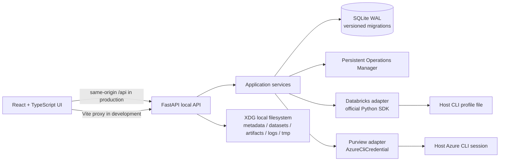
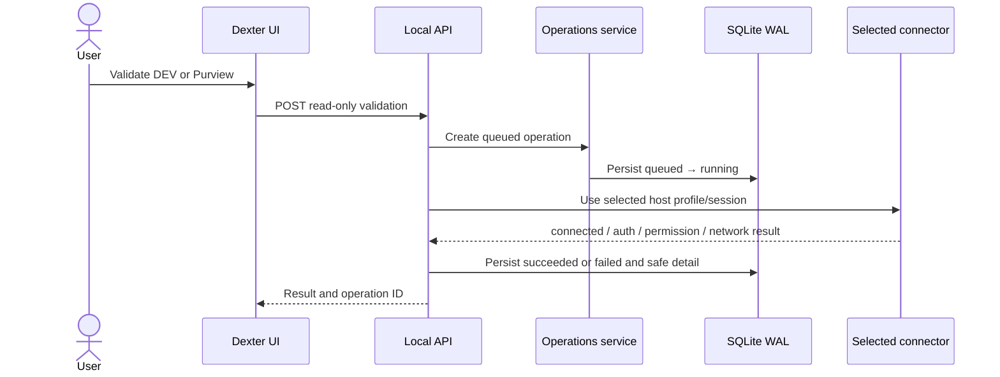
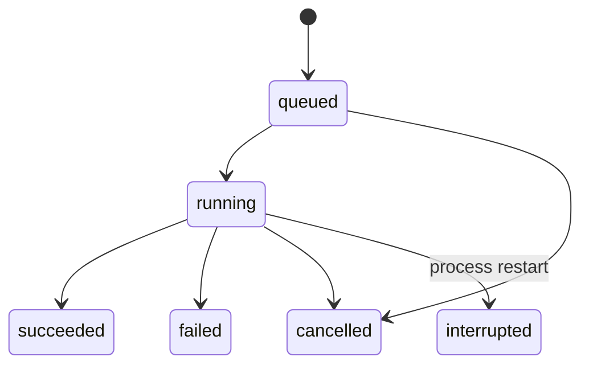

# Dexter architecture

## Runtime components

Dexter is a single local application with a React/Vite client and FastAPI HTTP adapter. The API binds to loopback, stores state in one SQLite database, and calls enterprise systems only when a user explicitly runs a connection check. Databricks and Azure SDKs are imported inside their adapters so app startup and local functionality do not depend on corporate access.

### Boundaries

- `domain/` contains operation transitions and typed F2–F4 contracts; it does not import FastAPI, SQLite, or vendor SDKs.
- `services/` implements use cases and persists only metadata, profile names, endpoint coordinates, operation states, and safe validation summaries.
- `db/` is the SQLite adapter: versioned migrations, WAL, a bounded busy timeout, serialized write transactions, and per-operation connections.
- `adapters/` contains read-only Databricks and Purview connector checks. Secrets remain owned by host CLI tooling.
- `api/` validates local requests, restricts origins/host headers, standardizes errors, and returns safe DTOs.
- `src/` is a dark, responsive platform shell for Home and connection settings. Discover and Ask Dexter are represented only by navigation/context affordances; future feature screens and data behavior are absent.

## Persistence and recovery

SQLite is embedded and local. WAL permits concurrent readers while SQLite serializes writers; `busy_timeout`, a small retry loop, and short `BEGIN IMMEDIATE` transactions bound contention. Migrations are recorded in `schema_migrations` and applied atomically. `synchronous=FULL` favors durable operation state. The database is stored under the XDG data home in `metadata/dexter.sqlite3`; future Parquet data, artifacts, temporary staging, and logs use separate sibling directories.

Operations use a checked state machine: `queued → running → succeeded | failed | cancelled | interrupted`. Queued work can be cancelled; running work records a cancellation request for a cooperative worker. On startup, work left in `running` becomes `interrupted` with `PROCESS_RESTARTED`. F1 does not spawn workers or claim cancellation for synchronous vendor calls.

## Connection checks

Databricks profile discovery reads only section names from the standard local config and Dexter's managed profile file. DEV/PROD references and validation results are stored separately; SDK clients receive exactly the selected profile and config file and execute a current-user GET. The paired setup command writes `DEXTER-DEV` and `DEXTER-PRD` only after both hosts validate. Both profiles use the current Azure CLI identity through `auth_type=azure-cli`; Azure CLI owns token storage. Existing external profiles and tokens are not copied or rewritten. There is no cross-environment fallback.

The guided flow is documented in [Databricks setup](databricks-setup.md) and its storage/authentication choice in [ADR 0007](decisions/0007-paired-databricks-profiles.md).

Purview endpoint saving performs only local validation. The explicit validation action requests `https://purview.azure.net/.default` from `AzureCliCredential`, checks the token's audience, and sends a GET to the configured read-only API path. HTTP 401, 403, connectivity failures, scope mismatch, and a delegated token incompatible with the default Atlas Data Map API are reported separately. The implementation never switches to service principal credentials. Microsoft documents Data Map data-plane roles and service-principal authentication; an existing delegated CLI session can therefore be incompatible with that selected API. See the Purview ADR for the exact constraint.

## Local API access

The server binds to loopback only. Requests must use a loopback Host, and browser Origins are allowlisted for local Vite dev/preview ports. CORS is limited to the same origins, methods, and `Content-Type`. Input validation responses omit submitted values, and unexpected errors return a request-safe generic message. In production, Vite's `dist/` can be served by FastAPI on the same origin; local dev uses the Vite `/api` proxy.

## Dependency policy

Install commands are wrapped in `scripts/dependency_tool.py`. A registry must be explicitly configured through Dexter variables, npm config, or pip/uv config. The wrapper selects one index, blocks unconfigured public defaults and Python `extra-index-url`, and keeps existing proxy/certificate settings. Public npm/PyPI use requires both a configured URL and `DEXTER_ALLOW_PUBLIC_REGISTRY=1`. npm lockfile tarball hosts are rewritten to the selected registry. `make doctor` reports configuration status without making network calls or revealing URLs.

## Future module contracts (not implementations)

The `domain/future_contracts.py` module records typed seams only:

- **F2 Unified Discover:** `DiscoverySource` and `AssetReference` allow Purview, Databricks DEV/PROD, and LOCAL providers to reconcile through one catalog. Existence, visibility, and read authorization remain separate fields. Loading, cache, reconciliation, and L/D/P indicators are not implemented.
- **F3 Local Analytics:** `MakeLocalSpec` requires selected columns and `copy_mode="full_snapshot"`. The publisher contract stages and validates a Parquet snapshot before atomically switching the active snapshot. Old data is retired only after publication. No DuckDB, Arrow, Parquet writer, or worker is included.
- **F4 Ask Dexter:** `ChatSessionReference` associates conversations with workspace IDs and a pinned or active-tab context. `AskSessionRepository` supports multiple sessions/conversations; no chat UI, OpenCode client, or conversation persistence is included.
- Later capabilities can add focused providers/services for synthetic data, table compare, labs, notebooks, orchestration, data products, and repository workflows without moving integration concerns into the core domain.

## Runtime and containerization

F1 runs on the host and needs no Docker daemon or external service. Later workers can be isolated behind the operations boundary. Keep credentials on the host: prefer a narrowly scoped local broker or host-side connector, do not bake CLI files or tokens into images, and never automatically mount all of `~/.azure` or all Databricks profiles into a worker. If a development-only mount is explicitly chosen, use a read-only mount of the selected profile, keep DEV and PROD separate, and protect token caches outside the image and build context.

## Decisions and verification

Architectural trade-offs are recorded in [ADRs](decisions/). Local test strategy and this F1 verification record are in [testing](testing.md).

## Unified Discover (F2)

`dexter.catalog.DiscoverService` loads source roots without contacting providers. Expanding a Databricks source loads catalogs; expanding a catalog loads schemas; expanding a schema loads tables. Opening a table loads its detail and column metadata. LOCAL discovery validates each `datasets/*/manifest.json` and requires its data file to resolve below that dataset directory. Purview expansion uses the configured endpoint and existing `AzureCliCredential` scope to probe the Unified Catalog preview Data Assets API; it does not fall back to Atlas or another identity. Provider pages are stored in the versioned `discovery_cache` table with a SHA-256 context key and level TTLs. Raw credentials and tokens are not included in cache records.

Databricks cache contexts include environment, profile reference, workspace host, current identity, and metastore when available. Purview contexts include endpoint, tenant, token identity claim, and audience. The explorer keeps provider trees separate, while a selected Databricks asset can show a Purview governance match when both are loaded and their metastore ID plus full qualified name match exactly. `catalog.reconcile` contains the same conservative identity rule. A single canonical tree is not yet built. Unknown permission evidence stays unknown; UC `browse_only` metadata is the only table-level read/restricted signal currently consumed.
