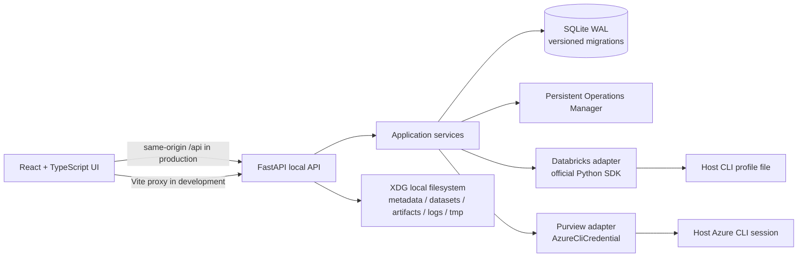
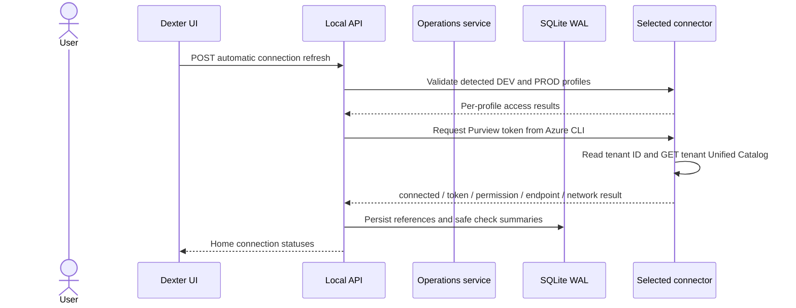
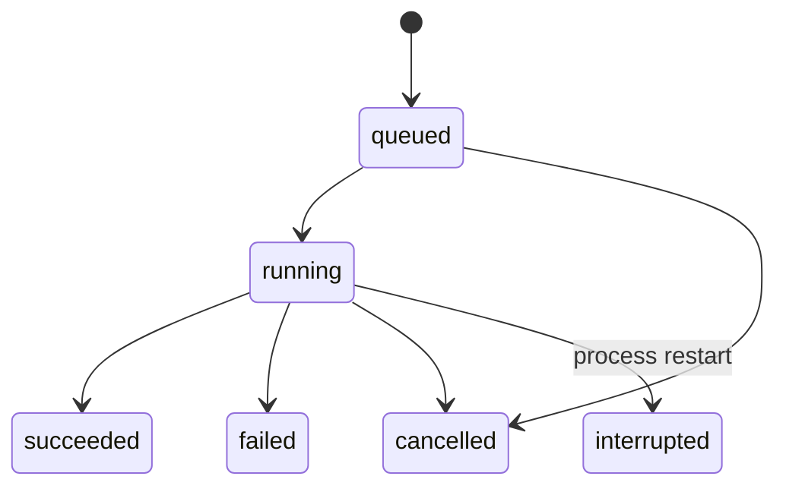

# Dexter architecture

## Runtime components

Dexter is a single local application with a React/Vite client and FastAPI HTTP adapter. The API binds to loopback and stores local state in one SQLite database. On startup, Dexter automatically checks local Databricks profiles and the current Azure CLI Purview session; Home can rerun these read-only checks. Databricks and Azure SDKs are imported inside their adapters so local functionality remains usable without corporate access.

### Boundaries

- `domain/` contains operation transitions and typed module contracts; it does not import FastAPI, SQLite, or vendor SDKs.
- `services/` implements use cases and persists only metadata, profile names, endpoint coordinates, operation states, and safe validation summaries.
- `db/` is the SQLite adapter: versioned migrations, WAL, a bounded busy timeout, serialized write transactions, and per-operation connections.
- `adapters/` contains Databricks, Purview, and Azure CLI connectors. Credentials remain owned by host CLI tooling.
- `api/` validates local requests, restricts origins/host headers, standardizes errors, and returns safe DTOs.
- `src/` is a dark, responsive platform shell. In Discover, the collapsible/resizable Explorer sits directly between the primary rail and central Table Workbench; Ask Dexter remains an independent right panel. Explorer state remains mounted while navigating between Home and Discover.

## Persistence and recovery

SQLite is embedded and local. WAL permits concurrent readers while SQLite serializes writers; `busy_timeout`, a small retry loop, and short `BEGIN IMMEDIATE` transactions bound contention. Migrations are recorded in `schema_migrations` and applied atomically. `synchronous=FULL` favors durable operation state. The database is stored under the XDG data home in `metadata/dexter.sqlite3`; Parquet data, artifacts, temporary staging, and logs use separate sibling directories.

Operations use a checked state machine: `queued → running → succeeded | failed | cancelled | interrupted`. Queued work can be cancelled; running work records a cancellation request for a cooperative worker. On startup, work left in `running` becomes `interrupted` with `PROCESS_RESTARTED`. F1 does not spawn workers or claim cancellation for synchronous vendor calls.

## Connection checks

Databricks profile discovery reads only section names from the standard local config and Dexter's managed profile file. DEV/PROD references and validation results are stored separately; SDK clients receive exactly the selected profile and config file and execute a current-user GET. The paired setup command writes `DEXTER-DEV` and `DEXTER-PRD` only after both hosts validate. Both profiles use the current Azure CLI identity through `auth_type=azure-cli`; Azure CLI owns token storage. Existing external profiles and tokens are not copied or rewritten. There is no cross-environment fallback.

The guided flow is documented in [Databricks setup](databricks-setup.md) and its storage/authentication choice in [ADR 0007](decisions/0007-paired-databricks-profiles.md).

Purview connection discovery uses the current Azure CLI session without Azure Resource Manager. Dexter requests the Purview audience token, reads its `tid` claim, builds `https://{tenant-id}-api.purview-service.microsoft.com`, and sends one read-only GET to Unified Catalog. It stores only the tenant ID, endpoint, API surface, and safe status summary; access tokens are never persisted. HTTP 401, 403, 404, and network failures report authentication, authorization, endpoint, and connectivity diagnostics. Discovery does not enumerate subscriptions or accounts, use Data Map, or fall back to a service principal. Microsoft's [Purview endpoint migration guidance](https://learn.microsoft.com/en-us/purview/migrate-to-governance-private-endpoints) documents tenant-specific `-api.purview-service.microsoft.com` endpoints; the request follows Microsoft's [Unified Catalog Data Assets List](https://learn.microsoft.com/en-us/rest/api/purview/purview-unified-catalog/data-assets/list?view=rest-purview-purview-unified-catalog-2026-03-20-preview) API.

## Local API access

The server binds to loopback only. Requests must use a loopback Host, and browser Origins are allowlisted for local Vite dev/preview ports. CORS is limited to the same origins, methods, and `Content-Type`. Input validation responses omit submitted values, and unexpected errors return a request-safe generic message. In production, Vite's `dist/` can be served by FastAPI on the same origin; local dev uses the Vite `/api` proxy.

## Dependency policy

Install commands are wrapped in `scripts/dependency_tool.py`. A registry must be explicitly configured through Dexter variables, npm config, or pip/uv config. The wrapper selects one index, blocks unconfigured public defaults and Python `extra-index-url`, and keeps existing proxy/certificate settings. Public npm/PyPI use requires both a configured URL and `DEXTER_ALLOW_PUBLIC_REGISTRY=1`. npm lockfile tarball hosts are rewritten to the selected registry. `make doctor` reports configuration status without making network calls or revealing URLs.

## Unified catalog and local analytics

Discover lazily reconciles provider pages over the F2 SQLite WAL cache. The tree is `Catalog → Schema → Table/View`, with physical variants retained on each logical node. The Explorer holds navigation and tree state; catalogs and schemas expand that same tree and do not create duplicate central lists. L/D/P indicators always represent environment existence: green means present, gray means confirmed absent, and amber/dashed means unknown. A missing page or permission does not count as absence. Table and view identity is shown with distinct icons; Purview-only assets with no read evidence use a lock and muted name. `browse_only=true` is metadata-only; `browse_only=false` is treated as read permission evidence; missing evidence stays unknown. A catalog ending exactly in `_dev` is normalized only when its non-suffixed counterpart exists in PROD; additional mappings can be supplied in `config/catalog-aliases.json` as a JSON object from physical name to logical name. Ambiguous same-environment collisions remain separate and are flagged. Tables merge across environments only when the containing logical catalog and schema/table path match and both providers expose the same metastore ID. Purview links to a Databricks table only when its `databricks://<metastore>/catalogs/.../schemas/.../tables/...` qualified name matches exactly.

Purview catalog browsing reuses the tenant endpoint detected from the Azure CLI token and makes read-only Unified Catalog requests with a current token. Connection status distinguishes authentication, authorization, endpoint, and network errors. Successful lazy reads store metadata in the existing identity-scoped cache and mark Purview connected; Dexter never escalates to a service principal.

Make Local uses the selected DEV or PROD profile only, verifies read evidence, and requires a warehouse already in `RUNNING`. It submits a full selected-column/filter query through Databricks Statement Execution with Arrow streaming and external result links. Signed links are memory-only and fetched without the workspace authorization header. PyArrow writes batches progressively to a staged Parquet file. Publication validates the file, atomically switches the active dataset row in SQLite, then retires the previous snapshot. The source key includes environment, workspace, metastore, catalog, schema, and table; one snapshot is active per source. Each explicit run executes a fresh full query; no incremental, CDC, or previous-snapshot reuse is performed.

The local dataset registry stores snapshot metadata and paths; table bytes live in Parquet. Its creation time, snapshot ID, byte count, and source environment are exposed in the unified catalog. At startup, Dexter validates the durable snapshot manifests and can rebuild missing SQLite index rows for both single-file and chunked snapshots; a restart does not request a new materialization. The SQL Workspace has an explicit Local/DEV/PROD destination; it never falls back to another environment. Local SQL runs in DuckDB with external access disabled and the selected Arrow dataset registered under the original table name; the legacy `local_table` alias remains available for existing SQL. Databricks SQL is sent as entered after a read-only single-SELECT check, with the selected physical object's catalog/schema as statement context and an explicitly selected SQL Warehouse. The untouched default query tracks the selected environment's physical table name; manually edited SQL is preserved. Warehouse listing is contextual; switching environments does not start compute, while Run may start a stopped selected warehouse through the existing authorized operation. Remote SQL is bounded to 500 returned rows. Result output reports columns/types when the engine response includes them, duration, target, selected object context, and SQL sent to the engine. A process lock protects local queries and deletion; a source reservation blocks deletion while a refresh is active. Make Local refresh validates a complete new snapshot before atomically switching the SQLite pointer and retiring the previous snapshot.

The SQL editor preserves its text across destination changes. Local SQL is executed against the selected snapshot's DuckDB namespace; remote SQL is placed in the existing bounded-result wrapper, without rewriting table references. Dexter does not yet resolve logical table references to different physical catalog names across DEV/PROD, nor does it register multiple local snapshots as a joined local namespace. Users must use physical names valid in the selected engine and local snapshots available to the local query session; unresolved references fail without a remote fallback. Execution details show both the editor text and statement sent to the engine. The current query API supports one read-only SELECT and bounded inline results; it does not provide query history, saved SQL, Explain, result pagination, or query cancellation. The UI does not advertise those unsupported operations. Delete Local Copy is only available from the snapshot card, confirms the snapshot identity/size, waits for local readers through the process lock, and returns a conflict while a materialization reservation is active. The same SQLite registry drives Explorer availability and SQL Workspace state.

Availability is separate from read permission. The local dataset index is complete for this machine, so a missing local variant is confirmed absent; DEV/PROD remain unknown when provider metadata is incomplete or failed. Explorer L/D/P continue to represent existence, not query authorization.

## Schema Engine and Compare Tables (F4.1)

`domain/schema.py` defines a provider-independent canonical schema and deterministic comparison model. It retains original type declarations, normalized type identifiers, precision/scale, nullable state, constraints, nested field structures, and safe provider-specific properties. Normalization unifies a small explicit set of primitive aliases and formatting while keeping the original representation for inspection. It does not attempt to normalize arbitrary vendor-specific complex types into an unsupported common meaning.

Compare Tables resolves each side through the physical variants already encoded by Unified Discover, then calls the existing Databricks table detail read for that environment. The clicked table and active environment establish a fixed contextual reference; users may choose another comparison object only on the other side. Comparison remains metadata-only: it does not list/start SQL Warehouses, run statements, read table rows, or write DDL. The detail cache in SQLite is reused; explicit Compare refresh bypasses it. If refresh fails, cached schemas are returned as stale with their original fetch time. Unknown availability, access denied, other metadata unavailability, incomplete metadata, and confirmed absence stay distinct. A confirmed missing table leaves the available schema visible and returns no field differences or compatibility score. PROD-only and DEV-only fields are facts when both tables exist, not pass/fail judgments. Type, nullability, and constraint changes request review, while extra fields alone are reported as structural differences without declaring incompatibility. The workbench stores the contextual source, target selection, filter, and result on the comparison tab. Ask Dexter receives both object names, environments, and structural counts without record samples.

## Synthetic data generation and Prepare DEV (F4.2)

`domain/synthetic.py` defines a serializable, destination-neutral `SyntheticGenerationPlan` over the canonical schema: row count (hard limit 1,000,000), per-column rule and parameters, null percentage, locale, seed, and publication intent. One generator registry defines provider, compatible scalar types, and uniqueness support; the same contract is returned to the UI and enforced by the domain validator. Type-based defaults use ranges or deterministic strings and never assign sequences to floating-point or ordinary text fields. Validation rejects unknown/duplicate columns, unsupported generators, impossible nullability, invalid ranges, and unsupported unique-value combinations. A generated seed and plan digest make the plan auditable and reproducible.

`services/synthetic_generation.py` is the generation engine. DuckDB handles typed sequences, ranges, dates, enums, booleans, null placement, casts, and Parquet writing. Mimesis is loaded only for explicitly semantic columns (names, email, company, address); it does not process every generated cell. One seeded provider advances in stable row-major field order, preserving values across chunk-size changes without creating a provider for every column. Schemas with unsupported complex destination types fail explicitly instead of being converted to strings. The generator estimates row cost from schema types, semantic rules, and literal sizes, then streams bounded Arrow batches through `ParquetWriter` as row groups. Fixed literals have a 64 KiB limit; enums allow up to 1,000 values and 1 MiB of text. New parts are capped at 10,000 rows and renamed atomically after the writer closes; incomplete temporary files are not checkpoints. DuckDB starts with a 64 MiB cap. The producer/consumer queue has one in-flight file and 128 MiB local staging limit, while the SDK uploads serial 4 MiB parts.

`POST /api/synthetic/review` resolves source metadata, DEV destination, schema, external location, grants, and a digest without writing data. A destination suggestion is returned only from a unique logical catalog/schema mapping in Unified Discover; table existence and target type are checked against DEV. External locations are ranked by mapped catalog/schema path, and automatic selection requires one unique high-confidence match plus verified effective grants. Publication strategy choices are limited by the real target's existence and writable Delta metadata. Existing-schema strategies use the selected DEV schema; the UI requires an explicit source switch before replacing custom schema edits. `POST /api/synthetic/runs` rechecks the review digest and queues a persistent operation. The five-step UI edits schema and generation rules, previews at most 100 rows, presents the server-generated publication plan, and tracks/cancels/resumes the operation. Preview results are bound to a digest of schema, rules, row count, locale, and seed; stale asynchronous responses are discarded. Operations and chunk manifests live in SQLite; staged Parquet files upload to a stable Databricks Volume run path, are verified by size and checksum where supported, and are materialized only after transfer validation. The publisher revalidates schema and row counts, records a run marker for recovery, and removes only the run's temporary remote files after success. It supports managed and external Create/Isolated, Append, and Replace paths, with existing external locations preserved for Append/Replace. Every publisher path rejects PROD.

An uncapped supervisor starts the worker in a 256 MiB cgroup v2 service with `OOMPolicy=kill` and watches the OS result outside that memory budget. The planner reserves 20% headroom, a fixed Python/DuckDB allowance and one serial upload buffer; its batch target is at most 8 MiB before an eight-fold expansion allowance. Before each record batch, Dexter checks `memory.current` against the 80% operational threshold. When no finite cgroup limit exists, it applies the same threshold to process RSS and reports that this is a guard rather than a hard ceiling. Confirmed systemd OOM results, typed DuckDB/Arrow/Python allocation failures, or Dexter's own memory guard trigger up to three adaptive generation retries; each halves the batch-row ceiling and DuckDB cap while retaining verified file checkpoints. An unexplained SIGKILL is recorded as an interruption, not assumed to be OOM. The worker cgroup contains generation and upload, so OOM, cancellation, or exhausted retry budget cannot leave its uploader running. Adaptive retry stops before publication and never crosses a destructive checkpoint. Drop & Recreate is available only for a table whose marker resolves to a completed Dexter experimental run on the same DEV profile/workspace and whose physical `table_id` is unchanged. A read-only review checks current storage, Delta format, schema, constraints, row filters/masks, visible grants and lineage, owner/MANAGE privilege, recovery policy, and the selected warehouse/schema/location privileges. It exposes the exact target and typed confirmation; after staging, Dexter repeats the fingerprint and validations, then atomically reserves the destination in SQLite and persists a no-retry checkpoint before submitting DROP. This target lock serializes multiple workers and survives process restarts. Any uncertain result after that checkpoint requires explicit reconciliation; workers never repeat DROP automatically. The reconciliation action checks the last statement is terminal and permits a new review only if the table is confirmed absent or the unchanged original still exists; a newly created/partially materialized table remains locked for administrator investigation. For Managed tables, current catalog/schema recovery retention is shown. External tables use a fresh empty path under a selected Unity Catalog External Location; old files remain untouched. Dexter preserves only validated Delta retention settings and its own provenance markers; unknown or credential-like table properties block this strategy. URLs with query credentials (including SAS) are rejected, and raw provider properties, credentials, and tokens never enter the review or run manifest. Successful publication forces a refresh of the open Unified Discover hierarchy. No real workspace write is part of automated certification. Preview remains local-only and removes temporary files.

Python packages are exactly pinned in `pyproject.toml`; `requirements.lock` must contain resolver-generated hashes and `package-lock.json` must match `package.json`. `scripts/check_dependency_lock.py`, `make setup`, `make upgrade`, `make lock`, and offline `make doctor` detect missing files, unpinned/drifted Python dependencies, missing hashes, and frontend manifest drift. After intentionally changing dependency pins, run `make lock` to resolve against the configured registries, then `make upgrade` to synchronize the virtualenv and npm modules from those locks. Lock generation is restricted to the single explicitly configured corporate registry for each ecosystem; the guard fails before resolution when an approved source is unavailable. A local ad hoc pip install does not certify or replace the project lock.

## Schema Evolution in DEV (F4.3)

`domain/schema_evolution.py` adds immutable schema drafts over the F4.1 canonical schema. Existing fields keep stable draft IDs, so an explicit rename remains a rename; the planner never infers renames from similar names. Draft storage is keyed by the authenticated local profile principal, workspace, DEV environment, physical table name, and Unity Catalog table ID. SQLite stores schema metadata, operation plans, progress evidence, and SQL only; credentials and access tokens are excluded. Draft updates are merged server-side against the stored baseline and accept only editable names, types, nullability, comments, and removal state.

The deterministic planner reuses the canonical schema comparison model and maps draft intent to ordered operations. Databricks-specific SQL lives in `adapters/databricks_schema_evolution.py`; identifiers and comments are escaped and types pass a conservative Spark SQL type allowlist. The API resolves the physical DEV variant again at review and apply time, checks profile/workspace/table identity, and rejects PROD or LOCAL targets server-side. No SQL is accepted from the browser.

Apply Schema Changes is the default, data-preserving strategy for managed/external Delta tables. ADD nullable columns, DROP/RENAME with Column Mapping, supported type widening, nullability changes, and column comments use direct ALTER statements. The shared searchable type selector accepts a bounded recursive Databricks type grammar; known aliases, DECIMAL parameters and complex types remain represented without accepting arbitrary SQL. Mapping and Type Widening are never enabled silently: Review checks the selected DEV Warehouse, permissions, table properties and protocol, then offers explicit opt-in when supported. Types requiring a rewrite are counted and blocked for direct Apply; unsupported types remain blocked. Adding a required column is blocked without a backfill strategy. Setting NOT NULL first checks the writer protocol and counts existing NULL values.

Recreate DEV Table is a separate, explicit destructive strategy from the same schema draft. It is available only for an eligible existing DEV Delta table after the shared F4.2 destination, grant, lineage, recovery-policy and storage checks pass. It performs DROP, confirms absence, and creates a new empty Delta table with the approved schema; it does not cast or load records, generate synthetic data, or use CREATE OR REPLACE. Review binds the destructive confirmation to the exact plan and physical DEV identity. A bounded allowlist of validated table properties is reapplied; unknown and credential-like values are omitted and reported without blocking schema recreation, and protocol versions are derived by Databricks rather than copied. Managed recovery behavior is shown. External recreation requires an authorized empty path under a selected External Location and leaves old files untouched. A durable pre-DROP checkpoint prevents blind retries; uncertain or partial results require metadata reconciliation. The new table must have a new table ID, match the approved schema and storage, and have zero rows before Dexter reports success. PROD remains rejected by the API.

The Compare Tables action can add missing PROD fields to the draft idempotently; new fields remain nullable and retain constraints for explicit review. Constraints that could be affected block direct destructive/type/nullability operations. Review can advance with no edits and clearly reports that there is nothing to apply.

The workbench and Compare Tables contextual actions open the same editor tab, preserving other workspace tabs. Review is generated by the backend; apply records operation state after feature activation, ALTER, DROP or CREATE, and re-reads the expected intermediate schema/capabilities. Cache invalidation is scoped to the configured DEV profile and physical schema; table-list pages are invalidated when a recreation can change table existence. DDL batches are not atomic: after a command failure or uncertain response, Dexter stores the completed/current operation and reconciled metadata, retains the draft, and requires explicit reconciliation and a fresh review. It does not claim rollback or blindly retry. After validated completion or reconciliation, the open Discover hierarchy and comparison cache refresh. Closing an editor discards its transient stage/session; reopening restores the persisted draft into Edit, never a saved Review/Apply/Validate screen. Schema Evolution does not call the synthetic generation/upload engine. Current SDK metadata does not prove every downstream consumer dependency; visible lineage is advisory and not exhaustive.

Version 2 review plans explicitly separate immutable physical DEV baseline, proposed DEV schema, and the advisory PROD reference. Semantic fingerprints normalize transport differences while retaining DDL-relevant fields, constraints and properties. Fresh physical schema and required capability evidence are observed together through Unity Catalog and checked again after Warehouse startup/NULL checks, before each feature change and structural DDL. Unknown metadata is an unavailable condition, not confirmed drift; stale Discover cache cannot authorize DDL. Each operation stores safe fingerprints and baseline-to-current/baseline-to-draft diagnostic differences. A failure before mutation preserves the original draft and editing origins and returns to Review. Partial/uncertain execution blocks further Apply until an explicit metadata-only reconciliation rebases remaining edits, after which a new review is required. See [ADR 0013](decisions/0013-dev-schema-evolution.md), the [targeted correction report](schema-evolution-state-fix.md), and the [F4.3 delta capability refinement report](schema-evolution-delta-refinement.md).

## Workflow state and verification

Workflow stabilization keeps an open React session per workspace tab, with only the active tab publishing Ask Dexter context. Synthetic editing/preview is independent of DEV publication verification; Append/Replace bind the effective schema and storage to observed physical DEV metadata. Editable PROD/DEV drafts retain separate schema/rule snapshots. Requests are bounded and obsolete metadata, preview, and review responses cannot advance a newer draft. Verification classifies confirmed absence/denial separately from connectivity and unknown metadata failures. Schema draft columns persist their editing origin without changing canonical schema diff semantics. Retried synthetic starts reuse the durable run associated with the same review ID. See [workflow stabilization evidence](workflow-stabilization.md).

## Ask Dexter conversations and OpenCode (F4.4)

Ask Dexter now uses the installed OpenCode Server through a loopback-only Dexter API. `adapters/opencode.py` isolates the server protocol; `services/opencode_runtime.py` discovers or starts a private server and resolves agent/model policy; `services/ask_dexter.py` validates turns, context and recovery; SQLite stores native-session references, model/context preferences and idempotent turn metadata. OpenCode remains the transcript source of truth. Dexter does not persist the transcript or provider credentials. The React panel is an always-mounted right-side workspace panel, so minimizing it does not discard the active conversation or stream.

New sessions default to the configurable native `build` agent with disabled tools and deny-all permissions at managed-profile, session and prompt layers. The model selector lists only connected OpenCode providers/models and prefers a discovered Luna 6 label without fixing a model ID. Each turn receives a versioned, bounded context snapshot from Table Workbench, Query Workbench, Compare Tables, Schema Evolution or Synthetic Data Studio. Active, pinned and selected-tab policies are resolved server-side by exact tab IDs. SQL literals/comments and token-like content are redacted; records/previews are not sent. Dexter filters native stream events by the session and reconciles history on reload. See the [F4.4 architecture and operations guide](ask-dexter-opencode.md) and [ADR 0015](decisions/0015-ask-dexter-opencode-integration.md).

## Future module contracts

The `domain/future_contracts.py` module records typed seams only:

- Ask Dexter/OpenCode is implemented for F4.4 as described above. `domain/future_contracts.py` still contains typed `ChatSessionReference` and `AskSessionRepository` seams for later domain-level composition; it is not the implementation of the current UI, adapter or SQLite repository.
- Later capabilities can add focused providers/services for row-level table comparison, labs, notebooks, orchestration, data products, and repository workflows without moving integration concerns into the core domain. F4.1's structural schema comparison is implemented separately in [ADR 0011](decisions/0011-canonical-schema-and-compare.md). Synthetic generation's reusable plan and engine are in [ADR 0012](decisions/0012-synthetic-generation-core.md).
- Cross-cutting UX and safety refinements for Compare Tables, Prepare DEV, and Schema Evolution are recorded in [ADR 0014](decisions/0014-workflow-refinement-contracts.md).

## Runtime and containerization

F1 runs on the host and needs no Docker daemon or external service. Later workers can be isolated behind the operations boundary. Keep credentials on the host: prefer a narrowly scoped local broker or host-side connector, do not bake CLI files or tokens into images, and never automatically mount all of `~/.azure` or all Databricks profiles into a worker. If a development-only mount is explicitly chosen, use a read-only mount of the selected profile, keep DEV and PROD separate, and protect token caches outside the image and build context.

## Decisions and verification

Architectural trade-offs are recorded in [ADRs](decisions/). Local test strategy and this F1 verification record are in [testing](testing.md).

## Unified Discover (F2/F3)

The unified Discover tree uses Databricks PROD as its structural inventory for catalogs and schemas, while DEV contributes environment variants. Expanding a schema loads Databricks table pages and queries the Microsoft Purview Data Map Discovery API with the current Azure CLI identity. The Data Map query is scoped to that schema by Unity Catalog metastore ID and qualified-name prefix, and follows continuation tokens until the result set is complete. Purview assets are joined to operational variants by metastore and full logical path; Purview remains the governance source for description, owner, and classification, while Databricks supplies environment presence and access. This lets a Purview-only table appear with metadata-only access when it is not visible through Databricks. LOCAL discovery validates each `datasets/*/manifest.json` and requires its data file to resolve below that dataset directory. Discovery stays lazy: no Purview table search runs until a schema is expanded. It never enumerates ARM subscriptions or falls back to another identity. Provider pages are stored in the versioned `discovery_cache` table with a SHA-256 context key. Cached catalog, schema, table, and Purview pages are reused regardless of age until an explicit refresh; the recorded TTLs indicate cache age but do not trigger API calls. Explorer refresh reloads the visible catalog roots, schemas only under expanded catalogs, and table/Purview pages only under expanded schemas, in that order. On a page reload, Discover enumerates cached listing-page keys for the selected local profiles and restores those catalog/schema pages from SQLite; it does not retain metadata in browser storage or trigger uncached page requests for search. Completing Make Local rebuilds the open tree from cache so local availability updates without forcing remote provider refreshes. Raw credentials and tokens are not included in cache records.

Databricks cache contexts include environment, profile reference, workspace host, current identity, and metastore when available. Purview contexts include endpoint, tenant, token identity claim, and audience. The unified tree groups matching physical catalogs and tables while retaining exact IDs and environment variants. `catalog/unified.py` uses the exact `_dev` rule and optional alias file; it does not infer identities from approximate names. Confirmed absence is an availability map on a logical node ID, never a synthetic provider variant; this keeps reconciliation state out of lazy child expansion. Availability reports existence separately from access. Cache pages remain provider-specific, so tree refresh does not discard F2 pages or require a full remote reload.
