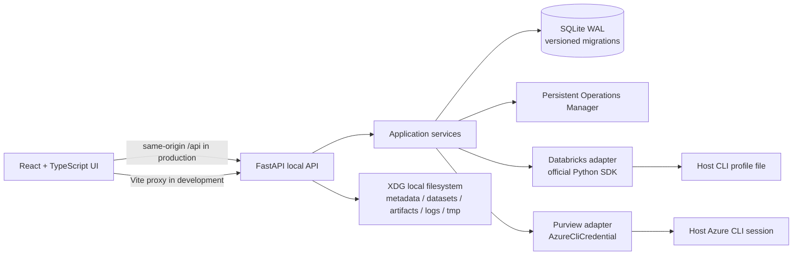
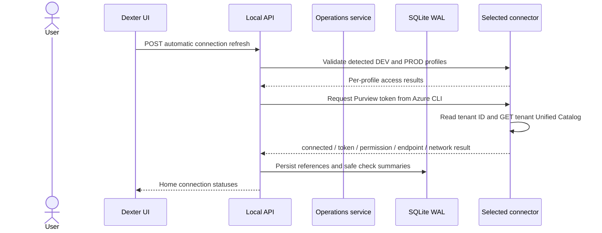
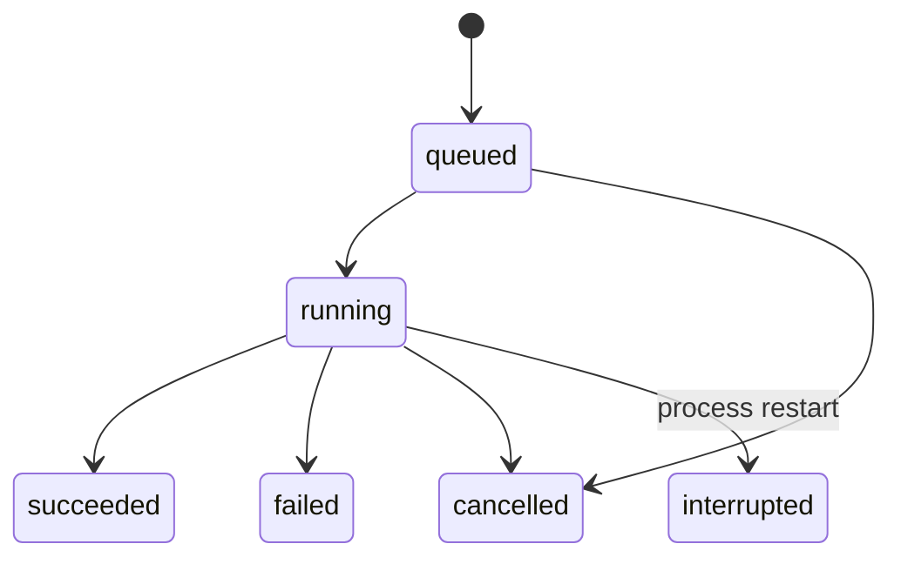

# Dexter architecture

## Runtime components

Dexter is a single local application with a React/Vite client and FastAPI HTTP adapter. The API binds to loopback and stores local state in one SQLite database. On startup, Dexter automatically checks local Databricks profiles and the current Azure CLI Purview session; Home can rerun these read-only checks. Databricks and Azure SDKs are imported inside their adapters so local functionality remains usable without corporate access.

### Boundaries

- `domain/` contains operation transitions and typed module contracts; it does not import FastAPI, SQLite, or vendor SDKs.
- `services/` implements use cases and persists only metadata, profile names, endpoint coordinates, operation states, and safe validation summaries.
- `db/` is the SQLite adapter: versioned migrations, WAL, a bounded busy timeout, serialized write transactions, and per-operation connections.
- `adapters/` contains Databricks, Purview, and Azure CLI connectors. Credentials remain owned by host CLI tooling.
- `api/` validates local requests, restricts origins/host headers, standardizes errors, and returns safe DTOs.
- `src/` is a dark, responsive platform shell. In Discover, the collapsible/resizable Explorer sits directly between the primary rail and central Table Workbench; Ask Dexter remains an independent right panel. Explorer state remains mounted while navigating between Home and Discover.

## Persistence and recovery

SQLite is embedded and local. WAL permits concurrent readers while SQLite serializes writers; `busy_timeout`, a small retry loop, and short `BEGIN IMMEDIATE` transactions bound contention. Migrations are recorded in `schema_migrations` and applied atomically. `synchronous=FULL` favors durable operation state. The database is stored under the XDG data home in `metadata/dexter.sqlite3`; Parquet data, artifacts, temporary staging, and logs use separate sibling directories.

Operations use a checked state machine: `queued → running → succeeded | failed | cancelled | interrupted`. Queued work can be cancelled; running work records a cancellation request for a cooperative worker. On startup, work left in `running` becomes `interrupted` with `PROCESS_RESTARTED`. F1 does not spawn workers or claim cancellation for synchronous vendor calls.

## Connection checks

Databricks profile discovery reads only section names from the standard local config and Dexter's managed profile file. DEV/PROD references and validation results are stored separately; SDK clients receive exactly the selected profile and config file and execute a current-user GET. The paired setup command writes `DEXTER-DEV` and `DEXTER-PRD` only after both hosts validate. Both profiles use the current Azure CLI identity through `auth_type=azure-cli`; Azure CLI owns token storage. Existing external profiles and tokens are not copied or rewritten. There is no cross-environment fallback.

The guided flow is documented in [Databricks setup](databricks-setup.md) and its storage/authentication choice in [ADR 0007](decisions/0007-paired-databricks-profiles.md).

Purview connection discovery uses the current Azure CLI session without Azure Resource Manager. Dexter requests the Purview audience token, reads its `tid` claim, builds `https://{tenant-id}-api.purview-service.microsoft.com`, and sends one read-only GET to Unified Catalog. It stores only the tenant ID, endpoint, API surface, and safe status summary; access tokens are never persisted. HTTP 401, 403, 404, and network failures report authentication, authorization, endpoint, and connectivity diagnostics. Discovery does not enumerate subscriptions or accounts, use Data Map, or fall back to a service principal. Microsoft's [Purview endpoint migration guidance](https://learn.microsoft.com/en-us/purview/migrate-to-governance-private-endpoints) documents tenant-specific `-api.purview-service.microsoft.com` endpoints; the request follows Microsoft's [Unified Catalog Data Assets List](https://learn.microsoft.com/en-us/rest/api/purview/purview-unified-catalog/data-assets/list?view=rest-purview-purview-unified-catalog-2026-03-20-preview) API.

## Local API access

The server binds to loopback only. Requests must use a loopback Host, and browser Origins are allowlisted for local Vite dev/preview ports. CORS is limited to the same origins, methods, and `Content-Type`. Input validation responses omit submitted values, and unexpected errors return a request-safe generic message. In production, Vite's `dist/` can be served by FastAPI on the same origin; local dev uses the Vite `/api` proxy.

## Dependency policy

Install commands are wrapped in `scripts/dependency_tool.py`. A registry must be explicitly configured through Dexter variables, npm config, or pip/uv config. The wrapper selects one index, blocks unconfigured public defaults and Python `extra-index-url`, and keeps existing proxy/certificate settings. Public npm/PyPI use requires both a configured URL and `DEXTER_ALLOW_PUBLIC_REGISTRY=1`. npm lockfile tarball hosts are rewritten to the selected registry. `make doctor` reports configuration status without making network calls or revealing URLs.

## Unified catalog and local analytics

Discover lazily reconciles provider pages over the F2 SQLite WAL cache. The tree is `Catalog → Schema → Table/View`, with physical variants retained on each logical node. The Explorer holds navigation and tree state; catalogs and schemas expand that same tree and do not create duplicate central lists. L/D/P indicators always represent environment existence: green means present, gray means confirmed absent, and amber/dashed means unknown. A missing page or permission does not count as absence. Table and view identity is shown with distinct icons; Purview-only assets with no read evidence use a lock and muted name. `browse_only=true` is metadata-only; `browse_only=false` is treated as read permission evidence; missing evidence stays unknown. A catalog ending exactly in `_dev` is normalized only when its non-suffixed counterpart exists in PROD; additional mappings can be supplied in `config/catalog-aliases.json` as a JSON object from physical name to logical name. Ambiguous same-environment collisions remain separate and are flagged. Tables merge across environments only when the containing logical catalog and schema/table path match and both providers expose the same metastore ID. Purview links to a Databricks table only when its `databricks://<metastore>/catalogs/.../schemas/.../tables/...` qualified name matches exactly.

Purview catalog browsing reuses the tenant endpoint detected from the Azure CLI token and makes read-only Unified Catalog requests with a current token. Connection status distinguishes authentication, authorization, endpoint, and network errors. Successful lazy reads store metadata in the existing identity-scoped cache and mark Purview connected; Dexter never escalates to a service principal.

Make Local uses the selected DEV or PROD profile only, verifies read evidence, and requires a warehouse already in `RUNNING`. It submits a full selected-column/filter query through Databricks Statement Execution with Arrow streaming and external result links. Signed links are memory-only and fetched without the workspace authorization header. PyArrow writes batches progressively to a staged Parquet file. Publication validates the file, atomically switches the active dataset row in SQLite, then retires the previous snapshot. The source key includes environment, workspace, metastore, catalog, schema, and table; one snapshot is active per source. Each explicit run executes a fresh full query; no incremental, CDC, or previous-snapshot reuse is performed.

The local dataset registry stores snapshot metadata and paths; table bytes live in Parquet. Its creation timestamp is exposed in the unified catalog so the UI can show snapshot freshness and offer a refresh through Make Local. The query editor supports Local, Databricks, and Auto execution; Auto prefers a local snapshot and otherwise uses the selected Databricks environment and SQL warehouse. Local SQL runs in DuckDB with external access disabled and the selected Arrow dataset registered under the original table name; the legacy `local_table` alias remains available for existing SQL. Remote SQL is restricted to one read-only SELECT and results are bounded to 500 rows. A process lock protects local readers from replacement/deletion. Operations persist progress, row/byte counts, safe logs, and cancellation requests. Resource caps are configurable in `$XDG_CONFIG_HOME/dexter/analytics.json` (`max_concurrent`, `max_queued`, `memory_limit`, `minimum_free_disk_mb`); defaults are 2 active workers, 2 queued jobs, 1 GB DuckDB memory, and 256 MiB minimum free disk. Restart recovery marks work interrupted and removes abandoned staging/orphan snapshots. Existing valid F2 top-level Parquet manifests are indexed at startup without provider reload.

## Future module contracts

The `domain/future_contracts.py` module records typed seams only:

- **F4 Ask Dexter:** `ChatSessionReference` associates conversations with workspace IDs and a pinned or active-tab context. `AskSessionRepository` supports multiple sessions/conversations; no chat UI, OpenCode client, or conversation persistence is included.
- Later capabilities can add focused providers/services for synthetic data, table compare, labs, notebooks, orchestration, data products, and repository workflows without moving integration concerns into the core domain.

## Runtime and containerization

F1 runs on the host and needs no Docker daemon or external service. Later workers can be isolated behind the operations boundary. Keep credentials on the host: prefer a narrowly scoped local broker or host-side connector, do not bake CLI files or tokens into images, and never automatically mount all of `~/.azure` or all Databricks profiles into a worker. If a development-only mount is explicitly chosen, use a read-only mount of the selected profile, keep DEV and PROD separate, and protect token caches outside the image and build context.

## Decisions and verification

Architectural trade-offs are recorded in [ADRs](decisions/). Local test strategy and this F1 verification record are in [testing](testing.md).

## Unified Discover (F2/F3)

The unified Discover tree uses Databricks PROD as its structural inventory for catalogs and schemas, while DEV contributes environment variants. Expanding a schema loads Databricks table pages and queries the Microsoft Purview Data Map Discovery API with the current Azure CLI identity. The Data Map query is scoped to that schema by Unity Catalog metastore ID and qualified-name prefix, and follows continuation tokens until the result set is complete. Purview assets are joined to operational variants by metastore and full logical path; Purview remains the governance source for description, owner, and classification, while Databricks supplies environment presence and access. This lets a Purview-only table appear with metadata-only access when it is not visible through Databricks. LOCAL discovery validates each `datasets/*/manifest.json` and requires its data file to resolve below that dataset directory. Discovery stays lazy: no Purview table search runs until a schema is expanded. It never enumerates ARM subscriptions or falls back to another identity. Provider pages are stored in the versioned `discovery_cache` table with a SHA-256 context key and level TTLs. Raw credentials and tokens are not included in cache records.

Databricks cache contexts include environment, profile reference, workspace host, current identity, and metastore when available. Purview contexts include endpoint, tenant, token identity claim, and audience. The unified tree groups matching physical catalogs and tables while retaining exact IDs and environment variants. `catalog/unified.py` uses the exact `_dev` rule and optional alias file; it does not infer identities from approximate names. Confirmed absence is an availability map on a logical node ID, never a synthetic provider variant; this keeps reconciliation state out of lazy child expansion. Availability reports existence separately from access. Cache pages remain provider-specific, so tree refresh does not discard F2 pages or require a full remote reload.
