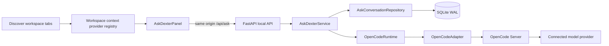

# Ask Dexter and OpenCode integration (F4.4)

## Scope

Ask Dexter is the local conversation surface for the current workspace. It connects the React panel to the OpenCode Server through Dexter's loopback API. OpenCode owns model execution, native conversation history, session state, and generation events. Dexter owns its conversation-to-session references, per-conversation model/context preferences, safe workspace snapshots, reconnection state, and the UI. The initial OpenCode agent is configurable and defaults to `build`; it is launched or invoked with tools disabled and deny-all permissions. The future `dexter` agent can replace `build` through configuration after its own tools and policies are designed. This module adds no data-engineering tools, SQL execution, DDL/DML, Databricks operations, or publication paths.

## Component map



| Component | Responsibility and contract |
| --- | --- |
| `src/AskDexterPanel.tsx` | Conversations, model/variant selectors, context modes, messages, streaming, stop, error and reconnect controls. It only calls Dexter API endpoints. |
| `src/askDexter/context.ts` | Version 1 workspace snapshot types and a small registry. A provider maps an existing workspace tab to a bounded context projection. |
| `src/App.tsx` | Receives `dexter:workspace-tabs` and `dexter:workspace-tab-context` events, merges the latest drafts, and supplies tab references to the persistent right panel. |
| `OpenCodeAdapter` | OpenCode HTTP/SSE protocol boundary: health, agents, connected models, native sessions/messages, prompt submission, abort and events. Provider credential fields are discarded. |
| `OpenCodeRuntime` | Validates endpoint policy, discovers an existing local server or starts a private loopback server, supplies the isolated `build` policy and reports available agents/models. |
| `AskDexterService` | Conversation use cases, turn idempotency, model/context validation, safe context projection, stream reconciliation and cancellation. |
| `AskConversationRepository` | Persists conversation references, preferences and turn state in SQLite. The OpenCode transcript remains canonical. |
| FastAPI `/api/ask/*` | Local request validation, error mapping and SSE delivery; it prevents the browser from connecting to OpenCode directly. |

### Context provider contract

The UI event contains a versioned snapshot:

```json
{
  "version": 1,
  "mode": "active",
  "active_tab_id": "stable-workbench-tab-id",
  "tabs": [{
    "tab_id": "stable-workbench-tab-id",
    "type": "schema_evolution",
    "title": "orders · Schema Evolution",
    "environment": "DEV",
    "resource": "sales_dev.gold.orders",
    "step": "edit_schema",
    "state": "ready",
    "summary": { "pending_changes": 2 },
    "columns": [{ "name": "order_id", "type": "BIGINT" }]
  }]
}
```

`WorkspaceContextProviderRegistry.register({ type, build })` is the extension point. Providers should project only existing UI state, include stable `tab_id` values, distinguish the selected environment and draft state, and omit records, preview cells, credentials and access tokens. Add a provider by registering its tab type and emitting the common `WorkspaceContextTab`; do not call new domain APIs from the chat. The backend independently validates and compacts the snapshot, so the browser is not a trust boundary.

The backend includes at most five tabs, 100 columns per tab, 24 KiB serialized context and 4,000 characters of SQL. SQL comments, quoted literals and numeric literals are removed before delivery. Token-like strings are redacted from titles, resources, SQL and user text. Raw table rows and preview values are never included. Context JSON is stored with the turn to make the exact context used for that request auditable and immutable; it is not used as a second transcript.

### Context selection rules

- **Follow active tab** is the default. At send time, the backend selects only the current `active_tab_id` from the UI snapshot.
- **Pinned** uses the exact pinned tab ID and stored projection. If that ID is not present in the current open-tab snapshot, no substitute tab is selected and the turn receives `pinned_tab_closed`.
- **Selected tabs** uses the stored selected IDs, capped at five. Closed selections are omitted and marked `selected_tabs_closed`.
- A context snapshot is resolved when a message is accepted. Changing tabs during generation cannot alter that turn's context.
- A new conversation starts in active mode and does not create when opening a workspace tab.

Current providers cover Table Workbench, Query Workbench, Compare Tables, Schema Evolution and Synthetic Data Studio. Schema drafts and synthetic configuration are represented only as structured summaries; generated data and preview rows are excluded. Query text is included only for the active Query Workbench and is sanitized server-side.

## Persistence and state invariants

SQLite migrations create `ask_conversations`, `ask_turns` and `ask_preferences`; a follow-up migration adds the OpenCode message baseline used to recover a response that finishes before the browser's SSE connection is established. Conversation rows store Dexter ID, local workspace ID, native session ID, agent ID, selected provider/model/variant, title, context preferences, sync state and timestamps. Turns store the request UUID, immutable compact context, state, error code and baseline remote message IDs. No transcript copy, credential, provider token or OpenCode server password is stored.

The workspace ID is a one-way hash of Dexter's local data-home path. This is a local single-user boundary, not an account system. SQLite remains WAL-backed with the rest of Dexter's local metadata. OpenCode session history remains the source of truth; the API does not mirror messages to SQLite.

Invariants:

1. One Dexter conversation has one native OpenCode session; different conversations never share that session.
2. One conversation has at most one `sending`/`running` turn.
3. A request UUID is accepted at most once, and retries do not submit duplicate prompts.
4. The browser's model is checked against the currently connected provider model list before use.
5. Only events for the requested session are forwarded to its stream.
6. Stop aborts only that conversation's OpenCode session.
7. Closing a workbench tab does not delete the conversation; an unresolved pinned/selected reference is reported as unavailable.
8. Dexter-owned OpenCode servers are stopped on application shutdown. Existing external servers are never terminated.

## OpenCode runtime and trust boundary

The connection order is: configured endpoint, an already-running local server at `127.0.0.1:4096`, then a Dexter-managed local server if one is needed. Endpoints must be a bare loopback HTTP origin or credential-free HTTPS origin. The browser sees only `/api/ask/*`. Managed OpenCode binds to `127.0.0.1`, uses a random in-memory HTTP Basic credential, a private Dexter-owned workspace/log directory and `--pure`; Dexter retains the native OpenCode auth store but does not pass API tokens or Databricks/Azure credentials through the server process environment. Logs are mode-restricted and provider credentials are not returned by model discovery.

The mounted Ask panel triggers startup through `GET /api/ask/status`; the API returns `starting` immediately while one background bootstrap validates the runtime. Concurrent status requests share that bootstrap. Readiness probes have a 0.75-second timeout and retry with a capped exponential delay for up to 45 seconds. The same bounded retry window applies to a configured endpoint. Once health succeeds, agent/provider metadata is fetched with five-second timeouts and up to three attempts. Authentication failures and invalid endpoint responses stop early. The UI polls status every 0.8 seconds while startup is pending, then shows the validated agent/models or a retry action. Dexter terminates only a managed child it started; it never terminates a configured or pre-existing OpenCode server. Shutdown and reconnect cancel outstanding retries.

The installed OpenCode version's actual API supports session-level permission rules and per-prompt `tools`. Dexter creates every session with `permission: * = deny` and sends every prompt with `tools: {"*": false}`. The managed profile additionally disables all tools, denies all permissions, and disables snapshots. These controls are sent in protocol requests as well as managed configuration; a system message is not the security control. If the configured agent is unavailable as a primary agent, the runtime reports it and does not silently switch agents.

This boundary removes OpenCode shell/edit tools from the F4.4 conversation. It does not make an external model provider local: when a connected provider is selected, the user message and compact workspace context are sent to it by OpenCode. The UI context summary lets the user inspect which tabs will be included. Content inside workspace context is explicitly marked untrusted in the system message and cannot grant tools or permissions.

## Model and agent policy

`select_preferred_model()` searches the connected model display names for both “Luna” and “6”; it does not hardcode a provider/model ID. In this installed OpenCode configuration, the preference resolves to **OpenAI · GPT-6 Luna** (`gpt-6-luna`). If no matching connected model exists, Dexter reports that fact and offers the connected models without silently choosing a fallback. The model and supported reasoning variant are stored per conversation. Variants are offered only when the provider metadata advertises them.

The agent ID defaults to `build` in `OpenCodeRuntime.DEFAULT_AGENT_ID`. It can be changed through local Ask settings or the persisted `ai.opencode.agent_id` setting, and must match an available primary OpenCode agent. The React code never fixes an agent ID. To move to the future `dexter` agent: install/configure that agent in OpenCode, verify its primary mode and reviewed permissions, select its ID through the same setting, then add only the separately approved tools and policies. Conversation, context, persistence and streaming contracts remain unchanged.

## HTTP and streaming contracts

| Endpoint | Purpose |
| --- | --- |
| `GET /api/ask/status` | Connection health, installed server version, available primary agents/models and preferred-model availability. |
| `POST /api/ask/reconnect` | Rechecks configured/local/managed connection. |
| `PUT /api/ask/config` | Saves the endpoint and agent ID, then reconnects. |
| `GET /api/ask/conversations` | Lists Dexter conversation references and active conversation ID. |
| `POST /api/ask/conversations` | Creates a native OpenCode session and persistent Dexter reference. |
| `POST /api/ask/conversations/{id}/active` | Persists current conversation selection. |
| `PUT /api/ask/conversations/{id}/title` | Renames native session and Dexter reference. |
| `PUT /api/ask/conversations/{id}/model` | Validates and persists connected provider/model/variant. |
| `PUT /api/ask/conversations/{id}/context` | Persists active/pinned/selected context policy. |
| `GET /api/ask/conversations/{id}/messages` | Reads native history and reconciles an interrupted/in-flight turn. |
| `POST /api/ask/conversations/{id}/messages` | Accepts a UUID-idempotent user turn and compact context snapshot. |
| `GET /api/ask/conversations/{id}/stream?request_id=...` | Streams session-scoped OpenCode generation events as SSE. |
| `POST /api/ask/conversations/{id}/stop` | Aborts and marks only that conversation's active turn cancelled. |
| `DELETE /api/ask/conversations/{id}` | Aborts if busy, deletes the native session when reachable and removes local metadata. |

SSE event types are `connected`, `generating`, `delta`, `replace`, `done`, `error`, and `reconnect`. A `replace` event is used when OpenCode finishes before the client attaches: Dexter compares native message IDs with the turn's baseline, returns the complete assistant message and closes the stream. SSE messages never contain other session IDs' content.

## Sequence diagrams

### Startup and connection

```mermaid
sequenceDiagram
  participant UI as Ask panel
  participant API as Dexter API
  participant R as OpenCodeRuntime
  participant O as OpenCode Server
  UI->>API: GET /ask/status
  API->>R: start background bootstrap if needed
  R-->>API: starting + attempt count
  API-->>UI: safe starting DTO immediately
  loop while startup is pending
    UI->>API: GET /ask/status
    API-->>UI: starting DTO
  end
  R->>O: short health probes with bounded retries
  O-->>R: healthy server
  R->>O: list agent and connected model metadata
  O-->>R: validated capability metadata
  UI->>API: GET /ask/status
  API-->>UI: connected state; preferred model if present
```

The runtime starts a managed server only when no configured or local server responds and the OpenCode executable exists. A missing provider/model is represented in status, not hidden by a fake response.

### New conversation, message, and streaming

```mermaid
sequenceDiagram
  actor User
  participant UI as Ask panel
  participant API as Dexter API
  participant S as AskDexterService
  participant DB as SQLite WAL
  participant O as OpenCode Server
  User->>UI: New chat
  UI->>API: POST /ask/conversations
  API->>S: create conversation
  S->>O: create session (build, deny all, preferred model)
  O-->>S: native session ID
  S->>DB: save reference + active ID
  API-->>UI: conversation reference
  User->>UI: Send message
  UI->>API: POST message + context snapshot + request UUID
  API->>S: validate, compact, redact, snapshot baseline
  S->>DB: create idempotent turn + context
  S->>O: prompt_async (tools false, agent, model, context)
  O-->>S: accepted
  UI->>API: EventSource for this conversation/request
  API->>O: subscribe to global native events
  O-->>API: message.updated / part.delta / session.status
  API-->>UI: session-filtered SSE deltas
  O-->>API: assistant message complete
  API->>DB: mark turn completed
  API-->>UI: done; UI reconciles native history
```

### Context modes

```mermaid
sequenceDiagram
  participant W as Workspace tabs
  participant P as Ask panel
  participant S as AskDexterService
  participant O as OpenCode
  W-->>P: active tab + open tab context projections
  Note over P: Active mode captures the current active ID at send time
  P->>S: message + current versioned snapshot
  S->>S: resolve saved active / pinned / selected policy
  S->>S: remove closed references; mark unavailable if necessary
  S->>O: user text + compact untrusted context system message
  Note over O: The snapshot is immutable for this turn
```

Pinned and selected modes use the stored exact IDs. If a referenced tab has closed, the API does not guess by title or resource name. Model/context changes persist per conversation and do not alter other conversations.

### Switch, reload, reconnect, stop and deletion

```mermaid
sequenceDiagram
  participant UI as Ask panel
  participant API as Dexter API
  participant DB as SQLite WAL
  participant O as OpenCode
  UI->>API: Activate conversation B
  API->>DB: save active conversation B
  UI->>API: GET B messages/status
  API->>O: read native history and session status
  O-->>UI: restored conversation-specific transcript
  Note over UI,API: Reload uses the same durable IDs; active request is reattached to SSE
  UI->>API: Stop B
  API->>O: abort B session only
  API->>DB: mark B turn cancelled
  UI->>API: Delete B
  API->>O: abort if busy; delete native session
  API->>DB: delete B reference/preferences
```

If OpenCode is unavailable, conversation references remain in SQLite; the panel shows a retry state and does not fabricate answers. A missing native session is marked `remote_missing`. Native history recovery after OpenCode/backend restart uses the OpenCode transcript plus Dexter turn/request references. A request that may already have reached OpenCode is never auto-submitted again.

The build-to-Dexter change is intentionally local: change the configured agent ID and verify its permission policy. No chat, session, context provider, or transport rewrite is required. The future agent and its domain tools remain outside this F4.4 implementation.

## Operations and troubleshooting

1. Install and authenticate OpenCode using its supported native CLI workflow. Dexter does not copy provider keys into its database or offer another credential editor.
2. Start Dexter normally. The mounted Ask panel checks a configured endpoint, an existing local server, then starts its own private loopback server when necessary. It reports “Starting OpenCode” during its bounded readiness retries. If Dexter reports `OPENCODE_NOT_INSTALLED`, install the OpenCode CLI and restart Dexter. If a configured endpoint reports unavailable, verify the endpoint and server; use Retry to run another bounded attempt. A manual `opencode serve --hostname 127.0.0.1 --port 4096` remains an option, but is not required for the managed startup path.
3. Open the panel's settings only to choose an available primary agent or configure a server endpoint. HTTP is accepted only for loopback; remote endpoints require HTTPS and must not contain a path, query, fragment, or embedded credentials.
4. Select a connected model. If Luna 6 is absent, connect it in OpenCode and choose Retry; otherwise choose a model explicitly from the returned list.
5. For “OpenCode unavailable”, use Retry and inspect the safe status/error code. Check that the CLI is on `PATH`, OpenCode authentication is current, endpoint is reachable, the selected agent is primary, and at least one provider is connected.
6. For an interrupted stream, reopen the conversation. Dexter reads the native session state and reconciles its last turn; do not resubmit the same prompt automatically.
7. For an unavailable pinned/selected tab, reopen the exact workbench tab or choose another context mode. Dexter does not retarget the conversation to a similarly named asset.
8. Dexter-managed process output is stored under its private local logs directory in `opencode.log`; server credentials are generated in memory and are not logged. Dexter's structured logs report safe OpenCode error codes rather than provider tokens or prompt context.

OpenCode's configured endpoint can be local HTTP or HTTPS. If the browser reaches Dexter through WSL, only Dexter's loopback listener is exposed to the UI; the browser does not connect to the OpenCode port. Existing OpenCode servers remain user-owned and are never stopped by Dexter.

## Extension guide

### Add a workspace context provider

1. Define a typed projector for the tab's already-available state in `src/askDexter/context.ts`.
2. Register the stable `type` with `workspaceContextProviders`.
3. Emit the common version 1 tab snapshot from the screen/workbench owner. Keep resource identifiers, environment, step and compact metadata; omit records and secrets.
4. Extend the backend allowlisted projection only when needed, keeping limits/redaction and adding unit tests for the new shape.
5. Add an integration assertion that the context is attached to the correct conversation and no other conversation.

### Change the default model

Change `select_preferred_model()` in `services/opencode_runtime.py` to express a label/capability preference based on discovered metadata. Do not set a fixed provider model ID. Add coverage for available, unavailable and ambiguous labels; leave manual model selection and per-conversation storage unchanged.

### Switch the OpenCode agent

Set `ai.opencode.agent_id` to an available primary agent. `build` is the initial default; the ID is not embedded in React. New sessions are created with that agent, and each prompt repeats the agent and deny-all policy. Confirm the selected agent retains disabled tools before changing the default.

### Integrate the future Dexter agent

Install a separately reviewed `dexter` agent in OpenCode, define its own least-privilege permissions and tool policy, and configure its ID through the existing agent setting. Add any approved domain capability behind dedicated Dexter services and explicit authorization in a later feature. Do not expose direct SQL, DDL/DML, Databricks or publication tools merely by changing the agent name.

### Extend the chat UI

Keep transcript and OpenCode protocol access in the existing API/service boundary. Add presentation controls to `AskDexterPanel`, use conversation-scoped API calls, include disabled/error/loading states, and preserve the panel while minimized. Keep the transcript sourced from OpenCode and avoid React-specific persistence in SQLite.
